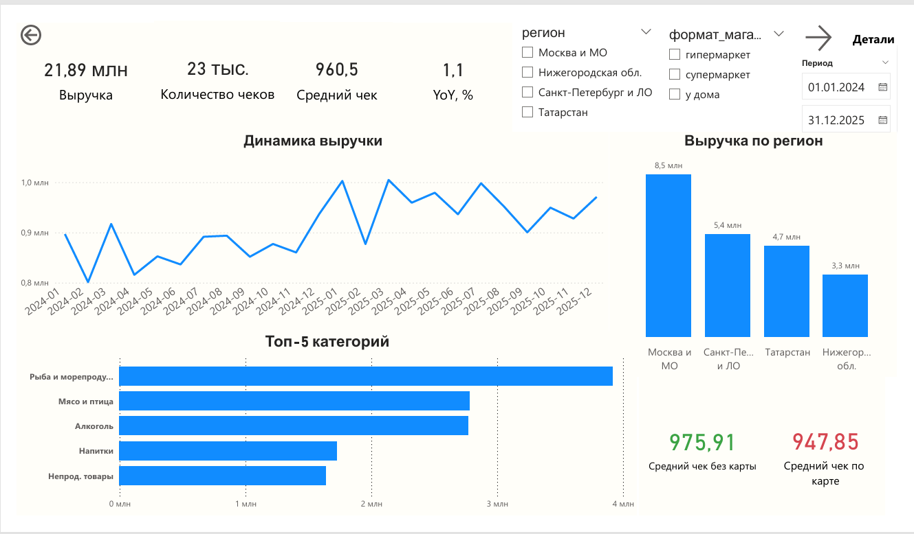
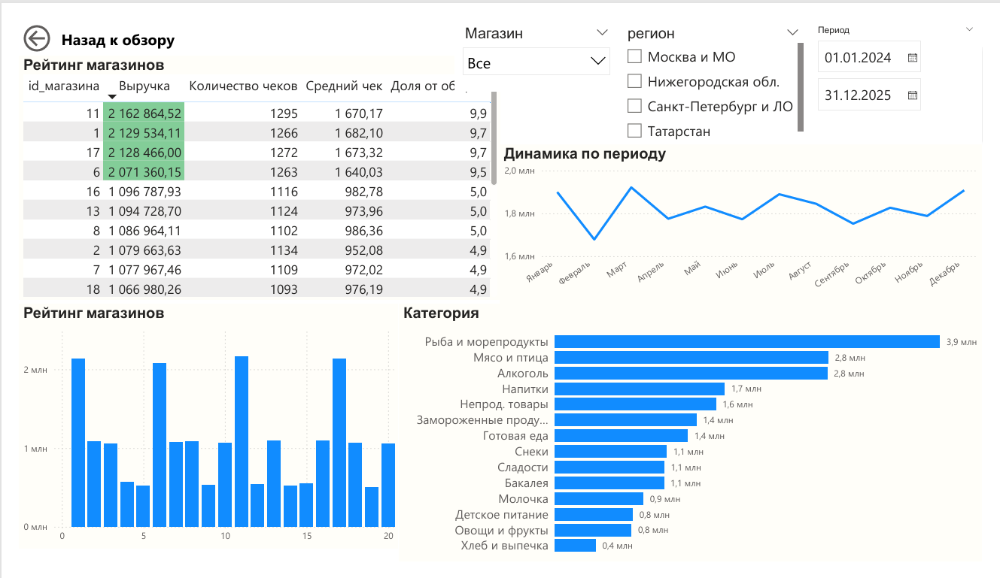

# Дашборд "Соседушка" — Анализ продаж розничной сети

## Скриншоты

### Страница "Обзор"

### Страница "Детали"

## Ключевые метрики

| Показатель | Значение |
|------------|----------|
| Выручка | 21,9 млн ₽ |
| Количество чеков | 23 тыс. |
| Средний чек | 960,5 ₽ |
| Рост YoY | +1,1% |
| Доля держателей карт | 86% выручки |

## Основные выводы

### 1. Стагнация роста
Бизнес показывает минимальный рост **+1,1% год к году**. Выручка колеблется от 0,72 до 0,92 млн ₽ в месяц без устойчивого тренда.

### 2. Перекос по магазинам
- **Топ-4 магазина** (20% сети) генерируют **39% выручки** со средним чеком 1 660 ₽
- **Аутсайдеры** (5 магазинов) имеют чек 480 ₽ при том же трафике
- Проблема не в отсутствии клиентов, а в низком среднем чеке

### 3. Программа лояльности -- фундамент бизнеса
Держатели карт совершают **86% покупок**. Разница в среднем чеке (-2,9%) несущественна на фоне частоты визитов.

### 4. Сезонность
- **Пики**: март (8 Марта), декабрь (Новый год)
- **Провалы**: февраль (пост-праздничная яма), сентябрь (школьный сезон), апрель (откат после марта)

  У компании крепкий фундамент (лояльная база, сильные флагманы, Москва), но рост упирается в перекосы — региональные, магазинные и сезонные. Ближайшие 6 месяцев стоит сфокусироваться не на экспансии, а на выравнивании эффективности внутри существующей сети. Это даст быстрый и дешевый прирост выручки.

## Файлы

- `Project_Sosedushka.pbix` - файл Power BI Desktop
- `Скриншоты/` - скриншоты дашборда
